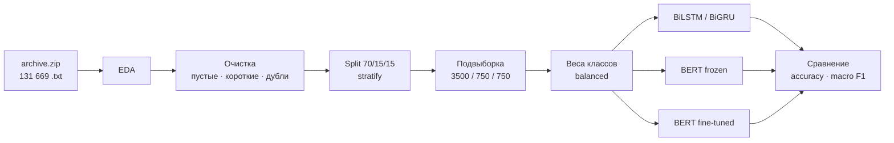

<div align="center">

# 🎬 Sentiment Analysis of Kinopoisk Reviews
### LSTM/GRU vs. BERT on Russian-language movie reviews

[](https://colab.research.google.com/github/USERNAME/REPO/blob/main/hw_transformers_sentiment_colab.ipynb)


*Домашнее задание «Трансформеры. Attention. Модели BERT, GPT» — Университет Иннополис,
программа «Инженер-архитектор в сфере искусственного интеллекта»*

</div>

---

## 📌 О проекте

Сравниваем классический рекуррентный подход и трансформеры на задаче классификации тональности
русскоязычных рецензий (**negative / neutral / positive**):

| Модель | Что обучается |
|---|---|
| **BiLSTM / BiGRU** (PyTorch) | 2 слоя, двунаправленная, эмбеддинги со случайной инициализацией |
| **BERT — frozen encoder** | только классификационная голова, вся база `requires_grad=False` |
| **BERT — fine-tuning** | вся модель целиком (`lr` 2e-5 … 5e-5, AdamW + linear warmup) |

Все три модели обучаются на **одной и той же стратифицированной подвыборке** и оцениваются на одном и том же test,
поэтому сравнение честное. Главная метрика — **macro F1** (классы несбалансированы), вспомогательная — accuracy.

## 🚀 Быстрый старт (Google Colab)

1. Нажмите на бейдж **Open In Colab** вверху.
2. `Runtime → Change runtime type → T4 GPU`.
3. Подготовьте данные — любым способом (ноутбук найдёт их сам):
   - загрузите `archive.zip` в корень **Google Drive**;
   - *или* загрузите `archive.zip` в `/content` (панель Files → Upload);
   - *или* ничего не делайте — ноутбук попробует скачать датасет через `kagglehub`.
4. `Runtime → Run all`.

> ⏱ Ориентировочно 10–15 минут на T4. На CPU всё работает, но BERT будет очень медленным —
> уменьшите `SUBSET_TOTAL` в ячейке конфигурации.

<details>
<summary><b>Локальный запуск</b></summary>

```bash
pip install torch transformers scikit-learn pandas matplotlib seaborn jupyter
jupyter notebook hw_transformers_sentiment_colab.ipynb
```

Положите `archive.zip` (или распакованную папку `dataset/`) рядом с ноутбуком.

</details>

## 📦 Данные

**Источник:** [Kaggle — Kinopoisk's movies reviews](https://www.kaggle.com/datasets/mikhailklemin/kinopoisks-movies-reviews)

Это не CSV, а набор `.txt`-файлов: один файл = один отзыв, класс = имя папки.

```
dataset/
├── neg/   1000083-0.txt   ← <id фильма>-<номер отзыва>.txt
├── neu/   ...
└── pos/   ...
```

> ⚠️ Датасет (~540 МБ текста) в репозиторий **не включён** — скачайте его с Kaggle.

### Что внутри (по результатам EDA)

| Класс | Отзывов | Доля |
|:---:|---:|---:|
| 🟢 `pos` | 87 138 | 66,2 % |
| 🟡 `neu` | 24 704 | 18,8 % |
| 🔴 `neg` | 19 827 | 15,1 % |
| **Всего** | **131 669** | 15 611 фильмов |

- Корпус: ≈ 298 млн символов, ≈ 44 млн слов.
- Длина отзыва: медиана ≈ **288 слов** (≈ 1 930 символов), 95-й перцентиль ≈ 750 слов.
- Распределения длин по классам **практически совпадают** — длина не выдаёт тональность.
- Дисбаланс **выраженный**: `pos` в 4,4× чаще `neg`.
- Пустых и слишком коротких (< 10 символов) отзывов нет; найдено 96 точных дубликатов — они удаляются.

## 🧭 Пайплайн



### Как решаем проблему дисбаланса

- **Стратифицированное** разбиение 70/15/15 — доли классов одинаковы в train/val/test.
- **Взвешенный `CrossEntropyLoss`** с весами `compute_class_weight('balanced')` (на train-подвыборке):

  | `neg` | `neu` | `pos` |
  |:---:|:---:|:---:|
  | 2.214 | 1.778 | 0.504 |

- Оценка по **macro F1**, а не только по accuracy.

## ⚙️ Гиперпараметры

<table>
<tr><th>BiLSTM / BiGRU</th><th>BERT</th></tr>
<tr><td valign="top">

| Параметр | Значение |
|---|---|
| emb_dim | 128 |
| hidden_size | 128 |
| num_layers | 2 (bidirectional) |
| dropout | 0.3 |
| optimizer | Adam, lr = 1e-3 |
| batch_size | 64 |
| max_len | 256 слов |
| epochs / patience | 15 / 3 |
| словарь | ≤ 30 000, `<pad>`, `<unk>` |

</td><td valign="top">

| Параметр | Значение |
|---|---|
| модель | `DeepPavlov/rubert-base-cased` ¹ |
| max_length | 256 токенов |
| batch_size | 16 |
| optimizer | AdamW, wd = 0.01 |
| scheduler | linear warmup (10 %) |
| frozen | lr = 1e-3, 5 эпох |
| fine-tuning | lr = 3e-5, 3 эпохи |
| AMP | fp16 на GPU |

</td></tr>
</table>

¹ Если модель недоступна — автоматический откат на `bert-base-multilingual-cased`.
Early stopping во всех экспериментах — по **validation macro F1** с восстановлением лучших весов.

## 📊 Результаты

> Таблица заполняется после запуска ноутбука — итоговые метрики сохраняются в `results_summary.csv`.

| Модель | Accuracy | Macro F1 | Обучаемых параметров |
|---|:---:|:---:|:---:|
| BiLSTM (2 слоя) | — | — | — |
| BERT frozen | — | — | — |
| BERT fine-tuned | — | — | — |

Ноутбук также строит: распределение классов (barplot + pie), гистограммы длин, кривые loss / F1 по эпохам,
classification report и confusion matrix для каждой модели, сравнительный barplot.

## ⚠️ Ограничения эксперимента

- **Подвыборка 5 000 отзывов** (вместо 131 тыс.) ради скорости BERT; на полном корпусе метрики, как правило, выше.
- **Усечение до 256 токенов** — рецензии длинные, поэтому модель видит в основном начало текста, а вывод автора часто стоит в конце.
- **Случайный сплит по отзывам, а не по фильмам** — часть test-отзывов написана о фильмах, которые есть и в train
  (ноутбук считает эту долю); строгий вариант — `GroupShuffleSplit` по `movie_id`.
- **Один seed, один сплит**, гиперпараметры не подбирались — при 750 test-примерах разница в 1–2 п.п. F1 может быть шумом.
- Метки — категория рецензии, вероятно выбранная самим автором; для `neu` граница размыта.

## 🔮 Идеи для улучшения

- Усечение «голова + хвост» или окна по 256 токенов с усреднением логитов
- Обучение на полном корпусе (~92 тыс. train-отзывов), аугментация редких классов (back-translation, синонимы), focal loss
- Другие модели: `ai-forever/ruBert-base`, `cointegrated/rubert-tiny2`, `xlm-roberta-base`
- Gradual unfreezing, дискриминативные learning rate, LSTM с предобученными fastText-эмбеддингами
- Поиск гиперпараметров (Optuna), несколько seed'ов, ансамбли

## 🗂 Структура репозитория

```
.
├── hw_transformers_sentiment_colab.ipynb   # основной ноутбук (EDA → LSTM → BERT → выводы)
└── README.md
```

## 🛠 Стек

`Python` · `PyTorch` · `🤗 Transformers` · `scikit-learn` · `pandas` · `matplotlib` · `seaborn`

---

<div align="center">
<sub>Учебный проект · Университет Иннополис</sub>
</div>
